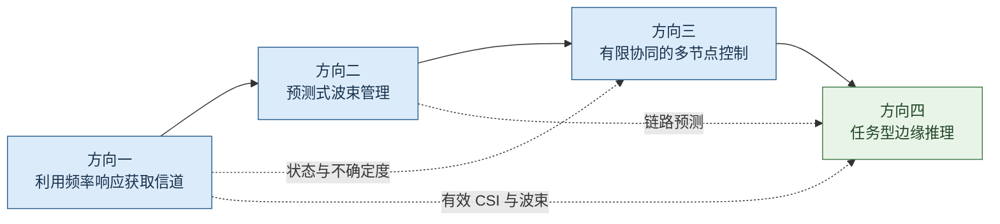

# AI Edge 赋能太赫兹 DMA/RHS 研究路线总纲

本文档规定研究主线、四个方向的逻辑关系和选题判据。概念与符号见 [公共模型](01_AI_Edge与太赫兹DMA_RHS的概念和公共模型.md)，文献证据见 [文献地图](02_文献地图与研究现状比较框架.md)。

## 1. 总体研究判断

本路线的核心对象是**受真实物理约束的太赫兹超表面收发机控制**。AI Edge 提供信道推断、状态预测、分布式协调和任务资源编排能力；DMA/RHS 提供低射频链、低维观测和可编程孔径。两者结合后的研究价值取决于 AI 是否解决了超表面架构特有的通信问题，而不是是否使用了某种神经网络。

四个方向可形成以下功能闭环；这表示输入输出关系，不规定论文完成顺序：

1. 从少量导频和可实现表面状态中获取当前通信状态。
2. 根据历史观测预测移动、阻塞和波束失配，提前更新表面状态。
3. 多个边缘节点在有限协调开销下联合控制 DMA/RHS，处理跨节点干扰和用户服务。
4. 将通信状态和表面控制接入边缘推理任务，联合分配传输、计算和任务资源。

## 2. 已确认的研究边界

研究采用理论分析和仿真验证，不把以下内容作为博士主线：

- 太赫兹器件制作、射频测试和依赖自建硬件的验证；
- 以收发端实测和数据拟合为主要贡献的太赫兹信道建模；
- 透明超表面的逆向设计；
- 以 ISAC 为主要场景（但是可以接受作为一个次要的场景或者创新点）；
- 需要超出 RTX 5070 或 2×RTX 3090 才能完成的训练规模。

离线训练、在线输出信道估计、波束或表面权重的模型属于本路线接受的 AI Edge 范围。论文仍需明确训练位置、推理位置和输出进入配置闭环的方式。

## 3. 四个方向的研究位置

| 方向 | 要解决的具体矛盾 | AI Edge 的作用 | 主要可验证结果 | 当前定位 |
|---|---|---|---|---|
| 1. 利用 DMA 频率响应的宽带信道估计 | 固定或少量配置下，多子载波观测能否替代部分时间扫描 | 结构化估计、配置选择与可选轻量学习 | 训练符号、导频 RE、切换、获取时延、NMSE 与有效速率 | 当前优先细化，首篇顺序未定 |
| 2. 预测式波束管理 | 移动和人体阻塞使窄波束在更新完成前失效 | 时序状态预测、不确定度估计、主动探测和多步控制 | 中断时长、有效吞吐、尾时延、训练开销 | 与方向一连续 |
| 3. 分布式多用户控制 | 多接入点局部观测不足，完整 CSI 交换又超过前传预算 | 学习型量化消息、图结构控制、双时间尺度决策 | 5% 用户速率、协调比特、推理时延、拓扑泛化 | 第二阶段扩展 |
| 4. 任务型边缘推理 | 中间特征的重要性、链路状态和边缘计算负载相互耦合 | 切分选择、特征保护、资源编排和任务损失优化 | 准确率、尾时延、能耗、传输量 | AI Edge 应用分支 |

## 4. 统一科学问题

四个方向共享一个可检验问题：**当太赫兹 DMA/RHS 的可实现观测和控制状态受频率响应、馈电传播、有限调谐及低射频链约束时，能否利用数据与模型结合的方法，以更低的通信和计算开销完成可靠状态推断与控制？**

这一问题可拆为四类假设：

- **H1，频域观测价值。** 在固定业务频段、RF 链、导频资源与能量条件下，利用可实现 DMA 频率响应和共享路径结构，能否减少时间扫描或配置切换，并保持通信性能。更少符号不自动等于更少导频，收益须扣除损耗、保护和校准成本。
- **H2，预测价值。** 当阻塞或波束失配具有可观测前兆时，预测式更新比增益阈值触发更新减少连续失联时间。
- **H3，协调信息价值。** 在固定前传比特数下，任务学习得到的协调消息比固定 CSI 摘要保持更高的边缘用户速率。
- **H4，任务联合设计价值。** 在链路和计算负载变化时，联合选择切分、特征保护和表面状态比通信与计算分离设计降低任务尾时延。

每个假设都应给出适用区间和失效区间。若收益只来自更大模型或更多先验信息，不构成超表面通信层面的有效结论。

## 5. 建议的研究顺序

### 5.1 第一阶段：建立物理与算法底座

当前优先细化方向一，但不要求它成为首篇论文。先用 LoS 或 LoS + 单反射的候选模型，检验真实 DMA 频响在固定业务频段内能否减少顺序扫描，再比较结构化估计与训练设计。近/混合场和失配按需加入；不以完成复杂交互下界或训练网络作为起步条件。公共信道、表面响应和评价模块可以被其他方向直接复用。

### 5.2 第二阶段：加入时间演化

方向二可使用方向一的路径参数、有效 CSI 或波束后验，也可先使用现有估计器或约定误差模型，不必等待方向一成文。预测器不直接依赖摄像头或雷达，输入限制为通信导频、历史波束、ACK 和吞吐反馈。先做状态空间模型与模型预测控制，再判断强化学习是否带来额外收益。

### 5.3 第三阶段：扩展到多节点

方向三复用方向一的低维状态和方向二的不确定度，将单站控制扩展到 cell-free 或用户中心网络。重点研究显式比特预算下的协调消息，不重复已有的集中式联合波束或一般分布式优化。

### 5.4 第四阶段：形成 AI Edge 服务闭环

方向四把通信状态、预测结果和表面控制接入分割推理。它适合成为扩展论文或博士后期综合工作。若物理层变量只作为固定速率公式，研究会退化为一般边缘计算，应收缩方向四并保持前三个方向为主线。

## 6. 阶段门槛与停止条件

2026-09-15 执行状态：D-024 的 300 GHz 随机波束中心自适应局部网格诊断已完成 100 个条件场景和 1200 行。F2 在局部细采样后消除了旧粗网格触发的距离伪峰；F1 后续 D-026 分解表明，300 条派生单径中有 40 条被相隔 1.773–2.193°的高相关角峰取代，且与 40 条全带失败逐条重合。Yang 的 28 个无噪声三径失败中，23 个包含单径失败，5 个只在多径叠加后出现。主限制由此收敛为当前单配置状态的角度弱区分性，多径贪婪选径为次要限制。当前不扩大全局字典，也不启动正式配置和新文献方法；下一步建议在相同 128 导频 RE 下先比较重新设计的单配置和少量互补配置控制组。具体结果见 [19 号文档](19_方向一Stage2A固定扇区诊断与下一验证.md)第 13–14 节及 D-025 至 D-026。

| 阶段 | 进入下一阶段前的门槛 | 调整或停止条件 |
|---|---|---|
| 方向一观测价值 | 现实模型与基线可复现；频域观测在统一资源下表现出可解释的训练价值 | 频响近似比例变化、损耗抵消信息收益，或只有增加资源才获得改善 |
| 方向一算法与训练 | 同等通信性能下降低获取成本，或同等资源下稳定改善性能 | 收益只来自错误模型基线、额外校准先验或忽略切换；经典算法已满足需求则不强加网络 |
| 方向二预测 | 阻塞或失配前存在可校准的预测信号 | 阻塞过程近似不可预测，预测控制不优于阈值触发 |
| 方向三协调 | 有限比特协调在重叠覆盖区域形成稳定收益 | 学习消息与简单干扰标量交换无显著差异 |
| 方向四任务 | 联合设计在尾时延或准确率—时延曲线上形成帕累托改进 | 结果主要由神经网络压缩贡献，表面物理控制无实质作用 |

## 7. 预期论文组合

以下为候选论文主题，不预定篇数与顺序：

1. **利用 DMA 频率响应的低开销宽带信道估计**：将观测条件、结构化恢复与少切换训练作为一条贡献链，先验证是否有净资源收益。物理分析不预先单独拆成论文。
2. **预测控制**：利用通信侧历史观测完成阻塞或波束有效性预测，联合主备波束与训练时刻。
3. **分布式或任务型综合工作**：根据通信收益与验证成本选择多节点协调或任务型边缘推理。

## 8. 当前未确认的设计选择

以下内容属于当前建议，尚未成为固定约束：

- 方向一从“单用户、上行 OFDM、基站侧接收 DMA”开始；
- 首篇论文选信道估计还是波束管理，以及四方向的实际推进顺序；
- 传统参数化、SBL、张量方法与轻量学习的取舍；
- 导频子载波、共享偏置和切换时序的具体联合设计方法。

方向一当前 M2 模型中的参数估计与重构 CSI 已按 D-028 归为同一估计链；该链相对直接波束任务基线的论文价值仍待验证。

2026-09-29 按用户决策 D-029/D-030，停止深挖频率可行性及既有 Yang/SBL 适配，转向宽带太赫兹 DMA 后验贝叶斯信道估计的几何信道原型。多 SNR 的 OMP/SOMP 与条件 LMMSE/Tikhonov 对照已完成；结果和先验信息条件见 19 号第 18–19 节。扩散先验尚未实现，独立数据源与分布偏移验证仍待设计。

这些选择及其变更记录在 [99_研究决策记录.md](99_研究决策记录.md)。

2026-10-01 用户确认 D-031：后续不再运行或展示当前 SOMP 和 Tikhonov，先实现常规宽带 SBL，再接入扩散先验。经典 SBL 采用全字典逐坐标边缘似然优化与后验均值 CSI 重构；原有几何信道和条件先验边界沿用。

2026-10-02：`stage2a_sbl_snr_20261002_v1` 已完成 3600 行，1200 次 SBL 均达到停止线。65 dB 的 F1/F2 全带 NMSE 为 −17.577/−22.012 dB，优于 OMP 的 −9.746/−15.818 dB，但落后历史条件 MC-128 LMMSE 的 −19.237/−26.406 dB。低 SNR 的 SBL 落后 OMP；F1 高 SNR 仍有尾部失败。详见 19 号第 20.4 节。 本轮为固定观测上的估计器对照，没有更改研究方向；后续 D-032 已接入条件扩散原型，完整训练和独立评价尚未完成，见 [19a 号文档](19a_方向一条件扩散原型.md)。

2026-10-04：D-032 数据准备与 10000 步训练已完成，首轮 16 场景验证完成 960 行且完整性核对通过。扩散的 192 个评价项全部 NMSE>0 dB，各组约 +3.34 dB；55 dB 的 F1/F2 条件 LMMSE 为 −14.838/−19.876 dB。两场景控制显示观测残差可降至噪声量级，但完整 CSI 与真值近乎不相关；每级步数 5→20 后进一步恶化。当前原型未通过验证，不进入独立测试；先验与采样误差仍需分离。 详见 [19a 号文档](19a_方向一条件扩散原型.md) 与 [核验报告](experiment_results/2026-10-09/diffusion_val_20261002_v1/analysis/audit_report.md)。

2026-10-04 D-033：已完成高斯得分、零空间误差与初始化诊断。条件初始化＋成对采样使无学习高斯扩散在两场景 55 dB 上与 LMMSE 的均值差小于 0.004 dB；修正学习模型的 F1/F2 为 −5.360/−6.178 dB，仍落后 LMMSE 的 −15.340/−19.092 dB。新网络仅训练 1000 步，未证实学习收益；14 项检查通过。完整训练命令已备妥，未启动独立测试。 详见 [19b_方向一扩散误差诊断与修正.md](19b_方向一扩散误差诊断与修正.md)。

2026-10-04 D-033 完整运行已核验：10000 步训练、16 场景验证 1152 行完整；768 条共同基线与旧运行逐项一致。55 dB 学习扩散 F1/F2 为 −7.190/−8.457 dB，仍落后 LMMSE 的 −14.838/−19.876 dB，全部 12 组配对 CI 均显示劣势。高斯对照高 SNR 最大偏差案例已定位到协方差截断；学习扩散仍有误差地板及 F2 高 SNR 尾部失稳，未进入独立测试。 详见 [完整运行核验](experiment_results/2026-10-09/diffusion_v4_val_20261004_v1/analysis/audit_report.md)。

2026-10-08 D-034：Zhou 全文、公开数据和代码已核对；旧阵列参考SNR与论文接收导频SNR不可直接比较。已有RF输出约17 dB的LMMSE为F1 −23.148/F2 −30.627 dB。已准备论文LMMSE/LASSO双归一化参考块和原DMA五方法−10:5:30 dB块，17项检查与小样本通过；完整曲线由用户运行，尚未声称复现一致。 详见 [19c_方向一Zhou参考场景与SNR曲线核对.md](19c_方向一Zhou参考场景与SNR曲线核对.md)。

2026-10-08 D-034完整曲线已核验：参考块各3600行、DMA1728行，来源/依赖/原始指标完整。20 dB下DMA的LMMSE F1/F2为−24.162/−32.464 dB，扩散为−6.401/−8.872 dB。论文参考逐样本与全局归一化明显改变曲线；共同接收功率横轴已后处理核对，数值与论文尚未逐点一致，3个30 dB的LASSO批次达到迭代预算。固定噪声、放大信号与现有噪声缩放等价，归一化层面仍待用户确认。 详见 [完整审计](experiment_results/2026-10-09/diffusion_observation_snr_20261008_v1/analysis/audit_report.md)。

2026-10-09 D-035：固定权重诊断定位到网络去噪误差与高 SNR 雅可比引导损失。v5 条件均值引导复用原模型，在两个所选验证案例的 30 dB 下，F1/F2 从 −10.959/−7.627 改善至 −17.876/−28.653 dB，仍落后高斯控制；19 项检查和 24 行标准入口通过。参考固定导频种子不足以解释论文高 SNR 约 4 dB 的差距；SNR 单位与物理模型保留。完整 v5 曲线由用户运行，见 [19d 号文档](19d_方向一扩散引导消融与SNR一致性核查.md)。

2026-10-09 D-035 完整 v5 验证已核验：1728 行齐全，1152 条传统基线与 v4 完全一致，288 次 SBL 收敛；模型、数据、SNR 标定和种子一致。30 dB 的 F1/F2 v5 为 −15.285/−27.023 dB，v4 为 −5.138/−11.782，LMMSE 为 −29.246/−40.289。18 组配对 CI 均支持引导修正改善，也均显示落后 LMMSE。组均值单调下降，高 SNR 仍有一个案例回升。未进入独立测试；详见 [19d 号第 9 节](19d_方向一扩散引导消融与SNR一致性核查.md) 与 [完整核验](experiment_results/2026-10-09/diffusion_v5_observation_snr_20261009_v1/analysis/audit_report.md)。

2026-10-09 D-036：固定权重先验诊断完成 144 条去噪和 96 条局部更新记录，240 次代数核对及 19 项轻量检查通过。训练案例也存在约 12–14 dB 的条件去噪差距；建议先验证条件高斯基准上的固定中心残差学习，尚未训练新模型。详见 [19e 号文档](19e_方向一学习先验差距与下一改进方案.md)。本次代码、配置、40 个运行的结果证据和测试记录保存于 [实验快照](experiment_results/2026-10-09/README.md)。

2026-10-09 D-037：用户确认在本地参数化数据上复现 Zhou DDPM/SURE-DM，复用物理平台，新增独立包与六阶段入口。35 个阶段运行和 27 项检查完成；完整 CNN 的 MIMO 短验证未超过 LASSO，SURE 去噪改善仅约 0.05–0.08 dB，DMA 暂只通过连通性。原论文数据分布与具体数值、正式训练和独立测试均未复现；结果及运行入口见 [19g 号文档](19g_方向一Zhou_DDPM与SURE_DM实现与最小验证.md)。19e 的残差模型方案仍为建议，不替代此次已确认路线。

2026-10-10 D-037：参数化 MIMO 的七个 DDPM/四个 SURE 长训练完成，21600 行共同验证和 7200 行 Clean 验证核验通过。20 dB 的 Clean DDPM 在 Np64/38 为 −25.578/−19.743 dB，LASSO 为 −18.158/−13.670；SURE 相对 Naive 的收益已在本轮验证出现。209 条 LASSO 补充迭代后全部收敛，组均值变化不足 0.002 dB。结果限于单种子及同一验证集选参与评价，不直接推广为原论文数值复现或 DMA 收益；独立测试、多种子及宽带长训练未运行。详见 [19g 第 7 节](19g_方向一Zhou_DDPM与SURE_DM实现与最小验证.md)。

2026-10-10 D-038：用户授权冻结 MIMO 模型和验证选参后的独立测试。七个模型、300 个数据文件和 144 个选参项核对通过；27 项检查及四项原验证复算一致。正式测试由用户运行，预期 100 场景、21600 行；本轮不重训、不调整算法、不启动 DMA 或多种子。冻结范围与完整命令见 [19h 号文档](19h_方向一MIMO冻结独立测试.md)。

2026-10-11 D-038：冻结模型和选参后的独立测试核验完成，100 个测试场景、21600 行完整；144 项选参、数据/模型/源码一致，24 项恢复复算一致。20 dB 的 Clean DDPM 在 Np64/38 为 −25.473/−19.589 dB；Clean 相对 LMMSE/LASSO、四种 SURE 相对各自 Naive 的配对区间均各为 18/18 组低于零。227 条 LASSO 补充后收敛，组均值变化不足 0.001 dB；4200 个高 SNR 相邻步骤无回升。本地 MIMO 核心算法与主要趋势完成独立验收，38 导频高 SNR 仍与原文数值有差距，不推广为原数据分布、多种子或 DMA 已验证。详见 [19h 第 6 节](19h_方向一MIMO冻结独立测试.md)。

2026-10-11 D-039：已按用户要求接通“传统参照—载频/吸收—宽带全数字接收—DMA”的分步扩展。40 项检查、15 个小阶段和 224 行连通性评价通过；新物理配置正式性能待运行。MIMO 的 OMP 不读取真值几何，真实几何 LS 单列；载频对照固定米制间距与物理噪声，宽带数字→DMA 对照复用相同 CSI 与先验。宽带单发射端二维接收结构与原 MIMO 不同，不能作为纯带宽消融。详见 [19i 号文档](19i_方向一传统参照与分步场景迁移.md)。

2026-10-13 D-039 正式核验：20 个阶段/144000 行完整，1520 个源码成员和 3552 个数据清单成员通过，六个测试冻结一致，64 项复算一致。原 MIMO 43200 条共同记录不变；40 GHz 的 DDPM 明显落后 LMMSE。宽带数字全频点的 30 dB 为 −32.291 dB，直接 LS 为 −29.901；16 点观测未观测域仅 −0.899 dB，DMA 全局 DDPM 约 0 dB。建议固定权重分解稀疏频域与压缩观测并加强基线，尚未实施；不以继续长训练替代诊断。见 [19i 第 11 节](19i_方向一传统参照与分步场景迁移.md)。原选题边界不变。

### 2026-10-13 D-041：当前排查顺序已确认

用户已确认关闭分子吸收，通过同一阵列和配对路径分布的窄带/宽带 × 数字/DMA对照，查明DDPM全带约0 dB的原因。优先补齐同阵列窄带DMA，先无噪声、足够配置，再减少配置和匹配接收SNR。当前主要问题是学习先验与在线恢复能否利用DMA投影重建完整CSI；具体原因仍待实验。

D-038的本地窄带MIMO收益、D-039的20阶段/144000行及失败证据保留。新无吸收对照尚未实施；非规则选频、全局LMMSE样本扫描、SURE迁移和多种子后移。本轮只完成本地决策、进度及接管整理，服务器克隆与代理连通性已核验，环境/大型输入/GPU实验未完成。详细边界见 [19i第13节](19i_方向一传统参照与分步场景迁移.md#13-d-041关闭吸收的最小对照与接管状态) 与99号D-041。
