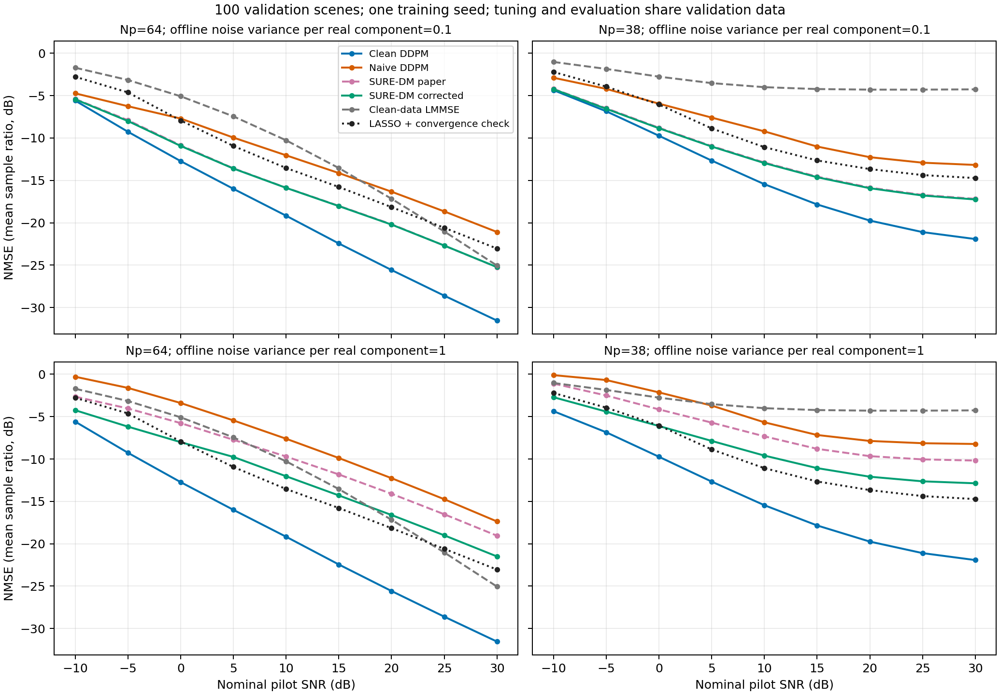

# D-037 MIMO 长训练与验证核验

日期：2026-10-10。范围：本地参数化 MIMO、单训练种子、验证集。

## Material Passport

- Origin Skill：academic-research-suite / experiment-agent
- Origin Mode：validate
- Origin Date：2026-10-10
- Verification Status：ANALYZED
- Version Label：zhou_mimo_validation_audit_v1

20 个阶段运行完成。7 个 DDPM 各 500 epochs/16000 次更新，4 个 SURE 去噪器各 100 epochs/3200 次更新。数据为 4096/256/100 场景，在线评价使用前 100 个验证场景。当前学习收益已在本轮验证中出现，未完成独立测试、多训练种子或 DMA 长训练。

300 个数据文件、11 个模型依赖、20 个源码 ZIP 的 1420 个成员与当前源码核对通过。共同验证 21600 行与单独 Clean 验证 7200 行均完整；7200 条共同记录的误差、SNR、选参和方法状态逐项相同，耗时不作相等核验。24 项固定恢复复算最大误差 3.55e-15 dB。原数据、权重和指标未改写。

## 1. 实际恢复误差

表中为场景线性 NMSE 均值转 dB。

| 方法 | Np64，20 dB | Np38，20 dB | Np64，30 dB | Np38，30 dB |
|---|---:|---:|---:|---:|
| Clean-data LMMSE | -17.168 | -4.295 | -25.055 | -4.261 |
| LASSO | -18.158 | -13.670 | -23.047 | -14.729 |
| Clean DDPM | -25.578 | -19.743 | -31.545 | -21.923 |
| Naive DM (0.1) | -16.336 | -12.264 | -21.091 | -13.179 |
| SURE-DM paper (0.1) | -20.180 | -15.853 | -25.245 | -17.181 |
| SURE-DM corrected (0.1) | -20.219 | -15.927 | -25.238 | -17.252 |
| Naive DM (1) | -12.263 | -7.870 | -17.370 | -8.227 |
| SURE-DM paper (1) | -14.104 | -9.664 | -19.049 | -10.184 |
| SURE-DM corrected (1) | -16.608 | -12.089 | -21.498 | -12.866 |

Clean DDPM 相对原预算 LASSO 和全局 Clean-data LMMSE 的配对 95% 区间在各 18/18 组完全小于零。四种 SURE-DM 相对对应 Naive DM 的区间也各为 18/18 组小于零。区间来自每组 100 个配对场景，144 次比较未作多重校正，只作为条件于当前模型和选参的描述性验证，不代表独立测试结论。

20 dB 下 Clean DDPM 相对 LASSO 的逐场景 dB 差均值：Np64 −7.236，95% 区间 [−7.455,−7.009]；Np38 −5.398，区间 [−5.885,−4.901]，分别 100/100 和 97/100 个场景改善。这与表内线性均值转 dB 后的差值是不同统计量。

## 2. SURE 数据输出与两种目标

| 实分量噪声方差 | 含噪 CSI | paper 输出 | corrected 输出 |
|---|---:|---:|---:|
| 0.1 | -6.970 | -14.050 | -14.009 |
| 1 | 3.030 | -2.482 | -5.393 |

以上使用全部 256 个验证 CSI，干净标签只用于核验，未用于 SURE 拟合或其检查点选择。低噪声时 paper 的去噪 MSE 略低，但 corrected 的多数在线配对误差略低，差异不足 0.1 dB；两种指标的排序不完全一致。高噪声时 corrected 的去噪和在线误差均更低；20 dB 的在线配对优势约 2.5 dB。两种目标的训练损失含不同散度系数，不能直接以损失数值比较效果。

Clean DDPM 在 t=1/25/50/75/100 的自然去噪 NMSE 为 −41.570/−14.411/−8.381/−3.306/+3.181 dB。高噪声端仍有误差，不能从在线恢复收益反推全部时刻的先验去噪都已准确。其他模型的去噪表使用各自 noisy/denoised 输入分布。

## 3. LASSO 迭代预算核验

原 1800 条 LASSO 记录中，209 条未达到停止阈值：Np38 的 25/30 dB 各 72/84 条，Np64 的 30 dB 为 53 条。保持原选定惩罚、原观测和停止阈值，预算提高至 10000 后 209 条全部收敛，实际迭代为 1005–2494 次。逐例 NMSE 变化为 −0.0581 至 +0.0504 dB；三个受影响组的线性均值转 dB 变化分别为 −0.001678/−0.001007/+0.000989 dB。本轮方法排序保持。惩罚仍由原 1000 次预算选择，此补充不是重新调参后的全量 LASSO 排名。原始曲线未替换，图中只将这 209 条按固定惩罚的收敛结果作敏感性展示。

## 4. 选参、尾部与时延的边界

100 个验证场景同时用于引导/惩罚选择和报告误差。独立测试文件未被评价，当前区间没有覆盖选参偏差或训练种子波动。Clean DDPM 的引导在 12/18 组选到候选上界 4；不能据此宣称引导已全局最优。所有七个学习模型的组均值随 SNR 下降；本轮 15→20、20→25、25→30 dB 的 4200 个逐场景相邻步骤均下降，见 high_snr_tails.csv。

| 模型 | 高 SNR 相邻步骤数 | 回升数 | 最大变化 / dB |
|---|---:|---:|---:|
| Clean DDPM | 600 | 0 | -0.396 |
| Naive DM (0.1) | 600 | 0 | -0.112 |
| Naive DM (1) | 600 | 0 | -0.031 |
| SURE-DM corrected (0.1) | 600 | 0 | -0.202 |
| SURE-DM paper (0.1) | 600 | 0 | -0.203 |
| SURE-DM corrected (1) | 600 | 0 | -0.106 |
| SURE-DM paper (1) | 600 | 0 | -0.055 |

本机为 RTX 4050 Laptop GPU，PyTorch 2.11.0+cu128。20 dB 的批量 1 记录中 Clean DDPM 为 Np64/Np38 0.140/0.129 s，Clean-data LMMSE 为 0.123/0.125 s；它包含当前分批信道合成和 I/O，未构成相同优化程度下的正式时延结论。

## 5. 统计解释核查：11/11

| 项目 | 核查结果 |
|---|---|
| Simpson 聚合反转 | 协议、SNR、训练噪声分别报告；低噪声两目标的细小排序变化保留 |
| 群体替代个体 | 同时报场景改善数；不把均值收益写成每个场景都改善 |
| 选择样本偏差 | 主比较使用固定前 100 个验证场景，未按误差筛除 |
| 碰撞变量偏差 | 主结果未按恢复成功过滤；未收敛子集只作明确的预算敏感性检查 |
| 基率忽略 | 100/100、97/100、209/1800 等分母均保留 |
| 回归均值 | 未从最差场景挑选主评价；短训练与长训练同时改变数据/预算，不作单因素归因 |
| 幸存者偏差 | 20 阶段、所有组和全部场景完整；未删除 209 条未收敛记录 |
| 多重寻找 | 144 个未校正的场景区间全部保存，不能当作共同显著性保证 |
| 分析自由度 | 原配置和候选预算保存；选参/评价复用验证集，独立测试待运行 |
| 因果外推 | 本轮只比较固定本地模型、观测和种子，不外推到其他信道分布/DMA |
| 反向因果 | 数据先生成，模型离线训练；SURE 修正的普遍优势未由单种子证明 |

## 6. 复现状态与来源

本轮为完整性核验、固定恢复子集复算和固定惩罚预算补充，未重新训练或全量重跑验证。源码/数据/模型与输入版本一致；结果不能称为已完成全量独立复现实验。未运行独立测试、多种子、DMA 长训练、QuaDRiGa 原分布或原文原图逐点一致检查。

- 完整性：integrity.json、run_inventory.csv。
- 配对：paired_comparisons.csv、paired_per_scene.csv；重采样 10000 次，种子 2026101001。
- 去噪：sure_denoising.csv、denoising_profiles.csv、training_history.csv。
- LASSO：lasso_extended.csv、lasso_curve_sensitivity.csv。
- 曲线与尾部：curves.csv、mimo_validation_curves.png/.pdf、per_scene_snr_steps.csv、high_snr_tails.csv。
- 固定审计：audit_zhou2025_mimo.py；图表/报告重建：make_report.py。
