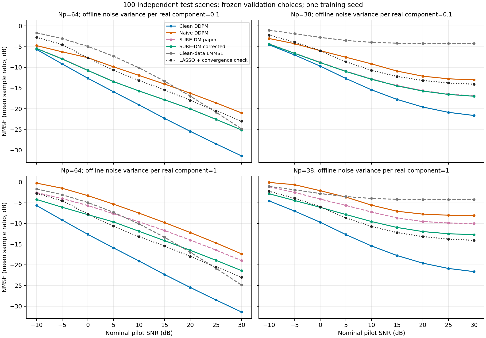

# D-038 MIMO 冻结独立测试核验

核验日期：2026-10-11。运行完成于 2026-10-10。本地参数化 MIMO、一个训练种子、100 个独立测试场景。

## Material Passport

- Origin Skill：academic-research-suite / experiment-agent
- Origin Mode：validate
- Origin Date：2026-10-11
- Verification Status：ANALYZED
- Version Label：zhou_mimo_independent_test_audit_v1

**DDPM/SURE 的主要性能趋势在冻结参数后的独立测试中得到重复验证。**本地核心算法与主要趋势的独立验收完成；原文 38 导频高 SNR 的数值、其他深度基线、量化/BER/时延及宽带 DMA 尚未复现。

## 1. 冻结与完整性

21600 行覆盖全部 100 个测试场景、两种导频数、九档 SNR 和 12 方法。144 个选参项与原验证逐项相同，选参文件 SHA-256 也相同。七个恢复模型、四个 SURE 数据生成依赖、300 个数据文件和 71 个源码 ZIP 成员核对通过。24 项固定恢复复算最大差为 3.55e-15 dB。原数据、模型、选参和指标未改写。

训练/验证/测试场景 ID 共 4452 个，三集合无重叠；归一化与协方差来自原训练数据。导频和噪声定义与原验证一致，测试观测噪声/初始化使用独立 split 种子分支。同一场景各方法共享观测，网络均为 100 次调用，未在测试误差上重选引导、惩罚或 SURE 版本。

## 2. 独立测试恢复误差

表中为逐场景线性 NMSE 均值转 dB，LASSO 使用原 1000 次预算。

| 方法 | Np64，20 dB | Np38，20 dB | Np64，30 dB | Np38，30 dB |
|---|---:|---:|---:|---:|
| Clean-data LMMSE | -16.961 | -4.238 | -24.887 | -4.213 |
| LASSO | -17.993 | -13.174 | -23.002 | -14.079 |
| Clean DDPM | -25.473 | -19.589 | -31.406 | -21.639 |
| Naive DM (0.1) | -16.255 | -12.141 | -21.016 | -13.031 |
| SURE-DM paper (0.1) | -20.016 | -15.645 | -25.134 | -16.902 |
| SURE-DM corrected (0.1) | -20.054 | -15.734 | -25.133 | -16.987 |
| Naive DM (1) | -12.204 | -7.750 | -17.351 | -8.101 |
| SURE-DM paper (1) | -14.010 | -9.527 | -18.973 | -10.033 |
| SURE-DM corrected (1) | -16.492 | -11.964 | -21.400 | -12.715 |

图中 LASSO 单列固定惩罚下的收敛补充；原始表和曲线另行保留。四种 SURE-DM 相对各自 Naive DM、Clean 相对干净 LMMSE/LASSO 的配对 95% 区间均各为 18/18 组小于零。原文系数版 SURE-DM 也有收益，不能将修正版的结果代替原文版本。

20 dB 下 Clean 相对 LASSO 的逐场景 dB 差如下，与表内线性均值转 dB 后的差是不同统计量。

| 导频数 | 配对 dB 差均值 | 95% 区间 | 改善场景数 |
|---|---:|---|---:|
| 64 | -7.319 | [-7.535, -7.097] | 100/100 |
| 38 | -5.987 | [-6.426, -5.537] | 98/100 |

高训练噪声下，corrected 对 paper 的配对区间为 18/18 组小于零；低训练噪声为 15/18 组，其余区间跨零，细小差异保留。这些是预定八种方法关系的 144 个未校正区间，每组 100 个配对场景、10000 次重采样，分析种子 2026101001。区间只描述当前固定模型和配置，没有覆盖训练种子或导频实现的波动。

## 3. 与原验证及论文的数值对照

| 导频数 | SNR | 原验证 Clean | 独立测试 Clean | 测试减验证 / dB |
|---|---:|---:|---:|---:|
| 64 | 20 | -25.578 | -25.473 | +0.104 |
| 64 | 30 | -31.545 | -31.406 | +0.139 |
| 38 | 20 | -19.743 | -19.589 | +0.155 |
| 38 | 30 | -21.923 | -21.639 | +0.284 |

七个模型的各组测试曲线减原验证曲线范围为 -0.191 至 +0.284 dB。两集合是不同场景，这里只比较组均值，不能把相同序号当作场景配对，也未将差值归因于单一因素。

[Zhou@2025，TWC](https://arxiv.org/html/2408.10501v2) 的 Fig.4/5 主曲线近似读数如下。原文主曲线采用增强版，本地为 T100 基础版；同时信道分布和训练样本规模不同。

| 导频数 | SNR | 原文 DDPM 主曲线，图读数 | 本地独立测试 DDPM |
|---|---:|---:|---:|
| 64 | 20 | 约 −25 | -25.473 |
| 64 | 30 | 约 −31～−32 | -31.406 |
| 38 | 20 | 约 −22 | -19.589 |
| 38 | 30 | 约 −28 | -21.639 |

64 导频的 DDPM 数值量级接近；38 导频在 30 dB 下仍比主曲线高约 6 dB。对照原文 Fig.3 同为 T100 基础版的 30 dB 曲线，其 Np64/38 约为 −29.5/−25 dB，本地 Np38 仍有约 3 dB 差距。38 导频的 LMMSE 在 20 dB 下原图约 −16 dB、本地 −4.238 dB，基线也未数值对应。

原文为 40 GHz QuaDRiGa、10 万训练场景，本地为 300 GHz 三径参数化模型、4096 场景。当前仅确认趋势与部分数值量级，尚未通过单因素实验分解剩余差距；本轮结果不能证明整篇论文或全部公式正确。

## 4. LASSO 收敛与高 SNR 尾部

原 1800 条 LASSO 中 227 条达到 1000 次预算：Np38 的 25/30 dB 为 72/91 条，Np64 的 30 dB 为 64 条。保持原惩罚、观测和停止阈值，预算提高至 10000 后全部收敛，实际迭代 1007–2364，中位数 1361。逐例 NMSE 改变为 -0.0388 至 +0.1112 dB；组均值变化最大绝对值 0.000842 dB。当前方法排序保持，补充没有在测试集重选惩罚，也未改写原始记录。

七个学习模型的组均值随 SNR 提高下降；15→20、20→25、25→30 dB 的逐场景变化如下。

| 模型 | 高 SNR 相邻步骤 | 回升数 | 最大 dB 变化 |
|---|---:|---:|---:|
| Clean DDPM | 600 | 0 | -0.331 |
| Naive DM (0.1) | 600 | 0 | -0.121 |
| Naive DM (1) | 600 | 0 | -0.040 |
| SURE-DM corrected (0.1) | 600 | 0 | -0.198 |
| SURE-DM paper (0.1) | 600 | 0 | -0.195 |
| SURE-DM corrected (1) | 600 | 0 | -0.086 |
| SURE-DM paper (1) | 600 | 0 | -0.056 |

本次 4200 个高 SNR 步骤均无回升。该结论限于这些测试场景和固定种子，不代表所有信道、SNR 或初始化都满足逐场景单调性。

## 5. 统计解释核查：11/11

| 项目 | 核查结果 |
|---|---|
| Simpson 聚合反转 | 分别报告导频数、SNR 和训练噪声，不以总体均值替代各组 |
| 群体替代个体 | 报告 100/100 与 98/100 等改善数，不宣称每例都优于基线 |
| 选择样本偏差 | 使用 test split 的全部 100 个场景，不按误差筛除 |
| 碰撞变量偏差 | 主结果不按恢复或收敛状态筛选；预算子集只作标明的敏感性检查 |
| 基率忽略 | 保留 227/1800、场景数、18 组及 4200 步的分母 |
| 回归均值 | 固定恢复复算使用预定 0/99 序号，不挑选最差场景；不作验证/测试单因素归因 |
| 幸存者偏差 | 全部方法/场景/组保留，227 条原预算未收敛记录未替换 |
| 多重寻找 | 预定 144 个未校正区间全部保存，不作共同显著性保证 |
| 分析自由度 | 原模型/选参/预算冻结，测试未重训、重选或择优停步 |
| 因果外推 | 结果限于当前合成分布、导频实现和训练种子，不外推至 DMA/QuaDRiGa/实测 |
| 反向因果 | 原数据先生成、模型离线训练；低噪声 SURE 版本差异未写成普遍优势 |

## 6. 复现范围与文件

用户运行的完整独立测试已核验；本轮只进行了固定恢复子集复算和固定惩罚收敛补充，没有重新训练或全量重跑 21600 行。核心算法及其主要趋势在本地 MIMO 完成独立验收。多训练种子、增强迭代、原文信道分布、其他深度基线、低位 ADC、BER、时延优势和 DMA 长训练仍未验证。

时延记录来自 RTX 4050 Laptop GPU、PyTorch 2.11.0+cu128，保留在原 CSV。LMMSE 的当前求解含分批信道合成/I/O，本轮没有做相同优化程度下的硬件时延比较。

- 完整性与依赖：integrity.json；原记录：../dependencies.json、../tuning_source.json、../code_manifest.json。
- 曲线：curves.csv、validation_test_curves.csv、mimo_independent_test_curves.png/.pdf。
- 配对：paired_comparisons.csv、paired_per_scene.csv。
- 收敛：lasso_extended.csv、lasso_curve_sensitivity.csv。
- 尾部：per_scene_snr_steps.csv、high_snr_tails.csv。
- 固定审计：audit_zhou2025_mimo_test.py、audit_zhou2025_mimo.py；报告重建：make_report.py。
