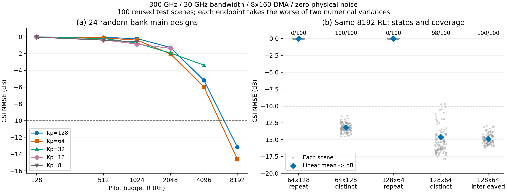

# D-041宽带预算扩展：正式结果核验

日期：2026-10-15。原运行前缀`d041_budget_sweep_20261015_v1`。

**增加导频预算后，宽带DMA的完整CSI恢复已通过当前预声明门槛。8192 RE下，64×128为−13.182 dB，128×64为−14.609 dB，交错128×64为−14.866 dB。重复同一DMA状态仍约0 dB。** 当前支持新增状态投影与频率覆盖共同影响恢复，不能把128 RE失败推广成DMA或宽带DDPM不可行。

## 1. 完整性与冻结

14个正式运行全部完成，覆盖24个共同随机库主设置及重复状态、交错覆盖、旧循环状态库和数字/J192参照，共80个算子。63360条最终指标、21120个案例JSON、2133120条VP轨迹完整；指标与全部案例、轨迹最终端点一致，轨迹t100至t0及网络调用计数完整，行/零空间分解通过。

1232个源码快照成员与启动清单和当前源码一致，全部运行复用同一无吸收数据和匹配Clean DDPM。数据2048/256/100、训练记录256000次更新、模型和数据哈希核对通过。每算子每数值方差从[0.5,1,2,4]选择引导，160个被选验证目标均与原始验证指标一致，最大相对差1.55e−8。所有测试在验证汇总冻结后启动，配置、权重与引导均从冻结记录读取。

原自动汇总manifest及原始指标重算通过，包括480个估计器汇总。22个固定GPU端点复算通过，最大NMSE差8.88e−16 dB，覆盖场景0/99的数字/J192、随机/旧库128 RE、4096 RE关键组和8192 RE控制。没有重选引导、改训练或运行源码。前次核验保留的35681个文件哈希保持；本次21607个原输入文件另存哈希清单。

128 RE旧循环库13组与此前测试的六项主要诊断指标逐项完全一致。9组全频新旧锚点的DDPM NMSE完全一致；其他指标最大绝对差2.16e−7，来自浮点算子路径，不是新增性能收益。正式日志未检出Warning/Traceback/Error；独立CPU核验中pandas对None/NaN的FutureWarning仅涉及表格比较的未来兼容性。真实GPU只读核对为2×RTX 3090、驱动595.99.02，固定复算正常；沙盒中的驱动探测失败不能用于判断实际GPU状态。

## 2. 系统结构与计数

单发射端，接收阵列8条微带、每条160阵元，共1280阵元；每微带模拟合并成1路，故每个导频RE提供8个复观测。中心频率300 GHz，带宽30 GHz、128频点，固定米制位置、三径、无吸收、静态CSI、零物理观测噪声。目标为所有阵元及全部频点的163840维复CSI。

同一DMA状态的真实频率响应和馈线传播随频率变化；改变状态提供新的空间投影，每状态保持一个训练符号。主组每状态使用相同的规则Kp频点；交错组保持相同J个状态和总RE，改为各状态轮换频点、均衡覆盖全部128点。重复状态控制保持相同时间、频点和RE，但仅使用首个状态，只有1个不同配置、0次切换。

资源R=J×Kp。所有比较固定完整信道、数据划分、模型权重、单位RE能量、噪声与评价口径；只改变预声明的预算、状态使用和选频。等RE不等于等时间：64×128需要64个训练符号/63次切换，128×64需要128个符号/127次切换，另按每次0.25符号保护记录。数字和J192只作非等资源连通性参照，分别约−70.519 dB，不参与等RE排名。本轮只扩展宽带评价，没有新增窄带预算实验。

## 3. 预算—性能关系

最终NMSE对每个场景取1e−8/1e−10两种数值似然方差中较差端点，再在线性域平均后转dB。它们不是物理观测噪声。测试复用原100场景；≤−10 dB比例是场景计数，不是该均值的另一个写法。

| 预算RE | 主设置数 | 全部主设置测试NMSE范围/dB | 达到−10 dB的场景比例 |
|---:|---:|---:|---|
| 128 | 5 | −0.045至−0.015 | 每组0/100 |
| 512 | 5 | −0.394至−0.077 | 每组0/100 |
| 1024 | 5 | −0.867至−0.201 | 每组0/100 |
| 2048 | 4 | −2.040至−1.270 | 每组0/100 |
| 4096 | 3 | −5.980至−3.376 | 每组0/100 |
| 8192 | 2 | −14.609至−13.182 | 128×64为98/100，64×128为100/100 |

预声明规则在共同随机库主组中选满足至少95%验证场景≤−10 dB的最少RE，再选最少训练符号。因此冻结工作点为**8192 RE、64×128**：验证32/32，测试100/100，测试−13.182 dB。128×64的平均NMSE更低，但不据此在test改选工作点。两者都通过原0.1 dB数值敏感性门槛；所有80个算子均通过，该轮最大测试差0.04519 dB来自J192参照。

8192只是本次六档网格中首个通过的预算。此前全频逐整数J扫描已在验证选择**J56=7168 RE**，冻结测试−11.231 dB、98/100通过。这一旧结果继续有效；当前未在4096与8192之间细扫，不提供新的全局最小RE或物理下限。

左图展示全部24主设置，连线只帮助读取离散预算点；右图灰点为每个场景、蓝菱形为线性均值转dB，上方计数为≤−10 dB的场景数。图没有误差棒；配对场景区间另存CSV。图源、PNG/PDF和绘图代码同目录保存，属于研究核验图，未按特定期刊排版。

## 4. 状态多样性与频率覆盖

| 预算 | J×Kp | 状态/覆盖方式 | 测试NMSE/dB | ≤−10 dB |
|---:|---|---|---:|---:|
| 4096 | 32×128 | 不同状态，全频 | −5.189 | 0/100 |
| 4096 | 64×64 | 不同状态，重复64点 | −5.980 | 0/100 |
| 4096 | 128×32 | 不同状态，重复32点 | −3.376 | 0/100 |
| 4096 | 128×32 | 不同状态，交错覆盖128点 | −6.102 | 0/100 |
| 8192 | 64×128 | 重复同状态，全频 | −0.015 | 0/100 |
| 8192 | 64×128 | 64个不同状态，全频 | −13.182 | 100/100 |
| 8192 | 128×64 | 重复同状态，重复64点 | −0.009 | 0/100 |
| 8192 | 128×64 | 128个不同状态，重复64点 | −14.609 | 98/100 |
| 8192 | 128×64 | 128个不同状态，交错覆盖128点 | −14.866 | 100/100 |

**改变状态带来有效投影；增加相同时隙不能替代它。** 8192 RE的64×128不同/重复状态相差约13.17 dB。零噪声下相同状态重复不会增加投影秩，不能把重复RE视为独立信息；这不排除带噪时重复用于平均噪声的价值。

**同RE下更多配置未必更好。** 4096 RE从64×64改到128×32，均值反而恶化2.604 dB；配对平均场景差+2.612 dB、95%区间[+2.564,+2.662]。这组设计为更多空间状态牺牲了频率采样，当前恢复器未从该取舍获益。8192 RE则128×64比64×128均值改善1.427 dB，说明有效分配随预算区间变化，不存在本轮证据支持的单调“J越大越好”。

**交错覆盖也有适用区间。** 4096 RE、128×32时，全带覆盖改善2.727 dB；同预算64×64交错反而略差0.124 dB。8192 RE交错较重复64点的线性均值改善0.257 dB，但配对平均场景dB差为+0.173 dB，95%区间[−0.099,+0.433]跨零，不能宣称其逐场景普遍更好。两种均值口径不同，少数较差案例对线性均值更敏感。

8192 RE重复64点的场景16/41分别为−9.726/−9.755 dB，交错后为−13.052/−12.958 dB，因此该测试集的过线比例改善主要体现尾部稳定性；完整100场景配对值已保存，未据这些案例修改协议或参数。配对区间采用10000次场景bootstrap、固定种子2026101546，仅作描述；未覆盖训练/状态种子，也未作多重比较校正。

128 RE随机状态库最佳主组16×8为−0.04487 dB，旧循环库相同计数约+0.000536 dB，二者均失败。更换状态库单独带来的这点差异不足以实现低预算恢复，不能用它替代预算因素。

## 5. DDPM是否真正补全了缺失信息

| 8192 RE设置 | DDPM/dB | 同观测伪逆LS/dB | 预测能量比 | 相关幅值 | 行空间NMSE | 零空间NMSE |
|---|---:|---:|---:|---:|---:|---:|
| 64×128，不同状态 | −13.182 | −2.157 | 0.7780 | 0.9807 | 2.46e−4 | 0.04782 |
| 128×64，不同状态 | −14.609 | −2.201 | 0.8081 | 0.9867 | 1.64e−4 | 0.03444 |
| 128×64，交错 | −14.866 | −2.174 | 0.8149 | 0.9872 | 3.35e−4 | 0.03228 |

三组观测秩均为65536，只有完整复CSI维数的40%，尚非线性满列秩。DDPM相对同观测伪逆改善约11.03/12.41 dB，结合零空间误差下降，支持学习先验在欠定观测下进行了有效补全。128×64主组只直接观测64个频点而输出128点完整CSI，当前全CSI指标支持该设置下跨频补全可行；未另行量化未观测频点单独NMSE。

观测残差分别约7.23e−4/4.60e−4/9.71e−4，不与CSI误差等同。预测能量仍只有真值的78%–81%，所以达到−10 dB门槛不表示“完美保持J192性能”。真几何LS约−144至−147 dB，读取额外真实路径几何，只验证条件恢复链路，不能用来证明未知几何下唯一可辨识。

以数值方差1e−8为例，以下为100场景的线性均值轨迹。t100是VP初态，不是干净信道；最终性能仍按两方差较差端点计算。

| 设置 | t | CSI NMSE/dB | 预测能量比 | 相关幅值 | 零空间NMSE |
|---|---:|---:|---:|---:|---:|
| 随机库128 RE、16×8 | 50 | +0.364 | 0.0968 | 0.0153 | 1.0872 |
| 同上 | 25 | −0.006 | 0.00845 | 0.0536 | 0.9984 |
| 同上 | 0 | −0.045 | 0.00744 | 0.1026 | 0.9897 |
| 8192 RE、64×128 | 50 | −3.634 | 0.4056 | 0.7631 | 0.4271 |
| 同上 | 25 | −7.185 | 0.5196 | 0.9215 | 0.1891 |
| 同上 | 0 | −13.182 | 0.7780 | 0.9807 | 0.04782 |

低预算最终输出能量很低、零空间误差接近1；高预算随迭代恢复相关性和能量，主要剩余误差仍在零空间。差异与“约0 dB的根源在缺失分量未补回”一致，但尚未唯一分离训练先验、近似后验引导和未知几何歧义。

## 6. 当前可下的判断与限制

本轮支持宽带DMA在当前匹配Clean DDPM、无吸收、无噪声条件下以欠定观测恢复完整CSI；128 RE不是唯一可用预算，也不能代表整个宽带场景。接下来比较配置—频率设计，应报告达到同一精度所需RE、训练符号、切换和保护成本，不只比较最优NMSE。

保留单训练/状态种子、复用100测试场景、静态训练窗口和当前引导网格限制。160组引导选择中90组取上限4，不能把当前工作点称为先验/恢复器的最优极限。无吸收、零噪声结果不能替代真实接收SNR下的评价或链路收益。没有新增训练、带噪、非规则选频、全局LMMSE样本扫描、SURE迁移或多种子，也没有修改原冻结选择或文献创新性判断。
