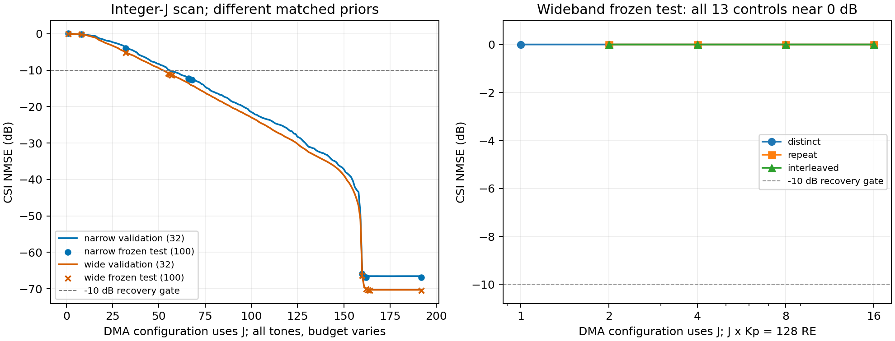

# D-041配置数与128 RE分配：正式结果核验

日期：2026-10-15。运行前缀`d041_config_sweep_20261014_v1`。

**当前DDPM可在中等压缩下恢复CSI，但少量配置、固定128 RE的完整CSI补全仍失败。不同DMA状态带来有效观测多样性，重复时隙不能替代它。** 接近J192的J161/J163工作点通过性能标准，但没有通过原0.1 dB数值方差敏感性门槛，不能作为稳定的“完美恢复最小配置数”。

## 1. 完整性、来源与冻结

6个正式运行全部完成，105264条最终指标、3543888条轨迹、35088个案例完整。验证覆盖窄/宽带各192个整数J、9组重复状态及数字参考，共各202个算子；宽带固定RE线13组。原始CSV与全部案例JSON一致，101个轨迹状态的计数/时刻和最终t=0指标一致。

510个源码ZIP成员与启动清单及当前文件一致。数据和模型依赖、原2048/256/100划分、每带宽各256000次更新、同带宽模型共享、无吸收与零物理观测噪声均核对通过。834项被选引导的验证目标均值与最终原始验证指标一致，最大相对差1.55e−8，仅来自浮点除法口径。三个冻结测试的配置及引导仅来自完成的验证运行；原`selection.json`、`test_confirmation.json`及指标均未改写。

20个固定GPU端点复算通过，覆盖两带宽的门槛及相邻配置、F1/F2/F3与交错F3，场景0/99；最大NMSE差为1.78e−15 dB。没有重训、扩展引导或在test重新选参。原D-041四组核验清单的4088个文件哈希保持；本轮35681个原运行文件另存SHA256清单。

## 2. 减少配置的影响

以下CSI NMSE先对每个场景取两个预声明数值方差中较差值，再在线性域求均值转dB。验证集32场景用于选J，冻结测试复用原100场景。

| 预声明标准 | 窄带验证选定J | 窄带测试NMSE | 宽带验证选定J | 宽带测试NMSE |
|---|---:|---:|---:|---:|
| 至少95%场景NMSE≤−10 dB | 67 | −12.552 dB，98/100通过 | 56 | −11.231 dB，98/100通过 |
| 平均损失≤0.5 dB，且至少95%配对场景损失≤0.5 dB，参考J192 | 161 | −66.786 dB，100/100场景满足损失标准 | 163 | −70.381 dB，99/100场景满足损失标准 |

J192测试参考分别为−66.871/−70.519 dB。J161/J163平均损失为0.085/0.138 dB；配置使用次数比J192减少16.15%/15.10%。−10 dB工作点相应减少65.10%/70.83%，但不能把约−12/−11 dB称为保持原−67/−70 dB性能。

测试中的窄带J66和宽带J55也分别有98/100、96/100场景通过−10 dB门槛。它们是预声明的边界核验，**不能据此在test重选更小J**。67/56是本状态库、先验、引导网格与32场景验证下的工作点，不是信息论下限或总体分布中已证明的最小值。

完整验证曲线给出更连续的精度—资源关系：

| J，全频不同状态 | 窄带验证NMSE | 宽带验证NMSE |
|---|---:|---:|
| 159 | −49.45 | −50.87 |
| 144 | −34.74 | −36.02 |
| 128 | −29.44 | −31.38 |
| 96 | −20.10 | −21.89 |
| 64 | −11.58 | −13.02 |
| 32 | −3.74 | −5.05 |
| 8 | −0.18 | −0.19 |
| 1 | −0.01 | −0.01 |

该表仅为验证曲线，不能与100场景冻结测试混写。窄带每配置1 RE，宽带每配置128 RE，因此宽带J56实际为7168 RE，不能按J数直接声称比窄带J67更低开销。两个带宽还使用各自匹配先验，差值不构成纯带宽因果效应。

窄带J67的DDPM相对同观测伪逆LS由−2.312改善至−12.552 dB，宽带J56由−1.852改善至−11.231 dB，约改善10.24/9.38 dB。这说明当前学习恢复在中等压缩下确有补全作用；成功并不局限于线性满秩观测。

## 3. 数值限制与引导边界

| 冻结测试配置 | 最大数值方差NMSE差 | 超0.1 dB的场景 | 最大线性NMSE绝对差 |
|---|---:|---:|---:|
| 窄带J161 | 0.368 dB | 46/100 | 2.85e−8 |
| 宽带J163 | 0.560 dB | 55/100 | 1.66e−8 |
| 窄带J160 | 2.743 dB | 100/100 | 2.85e−7 |
| 宽带J160 | 7.189 dB | 100/100 | 5.64e−7 |

接近J192的性能标准与数值稳定性是不同判据。原0.1 dB门槛保留，J161/J163不能宣称通过全部验收；超限发生在约1e−7的NMSE附近，绝对差很小，也不意味着工程CSI误差很大。两组J67/J56通过数值稳定性检查。

每个微带、每个频点有160个复未知量；J161/J163已处于逐频满列秩区域，接近数值平台的门槛可能受条件数、数值似然方差和求解误差影响，不能当作信道物理最小配置数。中等配置及多数少配置组的验证最优引导仍在上限4，最小J结论只对当前引导候选成立。

## 4. 状态多样性与时隙重复

下表为同J、同全部频点、同RE和相同静态CSI下的冻结测试；重复组一直保持首个状态，只有1个不同配置。

| 带宽与J | 不同状态NMSE | 重复同一状态NMSE |
|---|---:|---:|
| 窄带J192 | −66.871 | +0.086 |
| 宽带J192 | −70.519 | −0.015 |
| 窄带J32 | −4.055 | +0.086 |
| 宽带J32 | −5.189 | −0.015 |
| 窄带J8 | −0.131 | +0.086 |
| 宽带J8 | −0.201 | −0.015 |

重复192次仍接近单状态结果；不同状态的秩和有效约束增加。J32的配对平均场景dB差为窄带−4.204、95%区间[−4.416,−4.004]，宽带−5.191、区间[−5.261,−5.115]。区间采用10000次配对bootstrap，只覆盖场景不确定性，不覆盖训练/状态种子，未作多重比较校正。

这支持改变DMA状态带来有效多样性，不能把配置数的收益全部解释为重复观测或更长时间。本轮无物理噪声，不能推广成带噪时重复观测无用。

## 5. 固定128 RE的F1/F2/F3

| 主组 | 不同配置×频点 | 测试CSI NMSE | ≤−10 dB比例 | 预测能量/真值能量 | 平均相关幅值 |
|---|---|---:|---:|---:|---:|
| F1 C2 | 1×128 | +0.001071 dB | 0/100 | 0.0357% | 0.00683 |
| 新增 | 2×64 | +0.001012 dB | 0/100 | 0.0367% | 0.00714 |
| 新增 | 4×32 | +0.000947 dB | 0/100 | 0.0351% | 0.00714 |
| F2 | 8×16 | +0.000946 dB | 0/100 | 0.0371% | 0.00718 |
| F3 | 16×8 | +0.000536 dB | 0/100 | 0.0507% | 0.01002 |

全部13组均约0 dB，包括相同状态重复与交错全128频点覆盖，均未恢复完整CSI；最大数值方差敏感性低于8.1e−7 dB。F3相对重复状态改善约0.000972 dB，相对F1改善约0.000535 dB，没有实际恢复收益，不能据微小均值或显著区间宣称F3有效。

不同状态主组及交错组的总复线性秩均为1024；重复状态组的秩为1024/J。状态增加了独立投影，但没有让当前DDPM补回零空间。

F3观测相对残差约7.6e−6，行空间NMSE约1.94e−9，但零空间NMSE约1.00012，几乎全部CSI误差来自零空间；预测能量仅真值的0.0507%、相关幅值约0.010。其轨迹如下，采用数值似然方差1e−8、100场景线性均值，t=100为归一化VP初态，不是干净CSI：

| VP状态t | CSI NMSE | 预测能量比 | 观测相对残差 |
|---|---:|---:|---:|
| 100 | +25.59 dB | 361.28 | 40350.98 |
| 50 | +0.389 dB | 0.09385 | 0.1602 |
| 25 | +0.0199 dB | 0.004788 | 0.0894 |
| 5 | +0.000951 dB | 0.000499 | 0.0421 |
| 0，最终 | +0.000536 dB | 0.000507 | 7.51e−6 |

轨迹随恢复将估计能量压到很低，末段观测拟合改善，完整CSI和相关性没有恢复。真几何LS可恢复，但它读取额外几何；不能据此证明未知几何下唯一可辨识，也不能因DDPM失败认定128 RE物理上必然不够。

## 6. 结论边界与材料

已确认：中等配置下DDPM有压缩恢复作用；不同状态的收益明显强于同状态时隙重复；本次固定128 RE的状态/选频分配均未实现完整CSI恢复。未确认：稳定“完美恢复”的最小J、未知几何可辨识性、先验与引导各自的责任、带噪性能或跨种子稳定性。当前不改变研究方向或论文创新性判断，不自动开展新扫描。

核验与独立计算见`verification.json`、`replay.json`、`review_source.py`、`analysis_source.py`；原始来源哈希见`source_inputs.json`。`endpoint_summary.csv`、`validation_thresholds.csv`、`variance_sensitivity.csv`、`trajectory_summary.csv`和`paired_test_contrasts.csv`可用于复查数值。`run_records.zip`仅收录原指标与轻量元数据/硬件/源码，案例、大轨迹和频谱原文件留在runs、哈希记录在清单。未覆盖或修改任何原报告、测试选择和模型。
