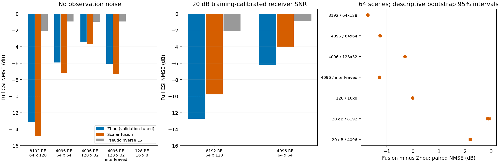
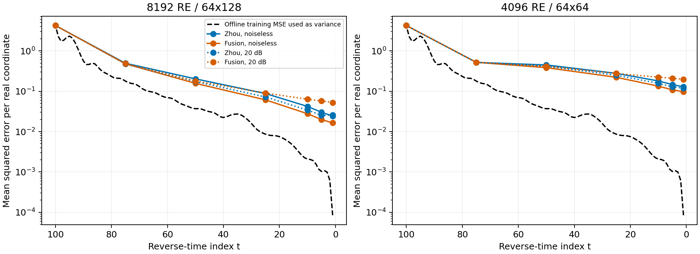

# D-041冻结先验与标量融合正式验证核验

2026-10-16。核验对象为用户完成的`d041_fusion_probe_20261016_v1_{calibrate,tune,screen}`。原运行、自动汇总、模型、数据、引导选择和以前报告均保留；本档案只保存独立复核及派生分析。

**本轮支持无噪声条件下的有限改进，不支持标量融合A1作为通用升级。** 8192 RE改善1.72 dB，两个4096 RE设置改善约1.2–1.3 dB，但4096 RE仍无场景通过−10 dB。20 dB观测下，A1在两组各64个场景全部落后原DDPM，8192 RE通过率由64/64降为32/64。当前应优先诊断在线方差适用性，而不是直接扩大协方差网络训练；这是后续建议，尚未实施。

## 1. 完整性与冻结执行

| 阶段 | 数据与用途 | 最终指标 | 反向状态 | 去噪均值诊断 |
|---|---|---:|---:|---:|
| 标定 | 256训练场景标定；32验证场景只作人工VP去噪诊断 | 人工去噪28800条，其中训练25600、验证3200；分解1120条 | — | — |
| 选参 | 验证0–31，原DDPM六个引导；A1和伪逆LS | 3072 | 271488 | 18816 |
| 冻结筛选 | 验证32–95，选定原DDPM、A1和伪逆LS | 2304 | 155136 | 10752 |
| 在线评价合计 | 5376个逐案例JSON，无非有限结果 | 5376 | 426624 | 29568 |

三个运行均complete、非smoke；标定完成后才选参，选参完成后才筛选。273个源码ZIP成员与各自清单和当前源码一致；父运行清单、数据/模型依赖及605个原数据文件哈希通过。100个标量方差逐项由训练行重算，验证误差未用于方差标定。所有DDPM案例均100次网络调用，初态配对，最终指标取t0；CSV与逐案例JSON、每步状态和网络去噪均值一致，102组自动汇总重算一致。

五个算子的状态/选频哈希、秩、不同状态数、全部2048训练场景参考功率与旧预算运行一致。新选参阶段的320个无噪声、固定引导4端点与旧预算验证结果一致。另在空闲RTX3090上固定复算20个端点和6条离线去噪记录，通过原定容差；端点NMSE最大绝对差5.56e−17，离线MSE最大相对差2.62e−15。

复算离线去噪时保持原四场景批量形状；改成单场景批量会改变浮点卷积计算。核验脚本开发时的格式/浮点一致性排错日志也保留，不属于原实验失败。行/零空间分解按complex64精度核验，原0.1 dB数值方差敏感性门槛保持；冻结筛选各组最大差2.12e−5 dB，全部通过。

两个旧结果清单共57288个文件、182个既有实现文件、上轮交付清单和本轮5541个输入文件均保持哈希。原日志也保留。机器证据见[完整性](verification.json)、[GPU复算](gpu_replays.json)、[硬件及标定](legacy_metadata.json)、[保留核验](preservation.json)和[原输入清单](source_inputs.json)。

## 2. 64场景冻结筛选结果

固定原300 GHz、30 GHz/128点、单发射端、8×160米制接收DMA和8 RF链，无吸收。网络、归一化、状态与选频沿用原数据/模型；A1只多一个离线训练误差标量方差表，没有新增网络训练。同一算子内观测、噪声和初始化相同。以下均为完整CSI NMSE：先在线性域求均值再转dB。无噪声先取每场景两种数值方差的较差值。

| 条件 | RE与配置×每配置频点 | 原DDPM，dB | A1，dB | A1相对均值变化 | ≤−10 dB，原→A1 |
|---|---|---:|---:|---:|---|
| 无观测噪声 | 8192，64×128 | −13.105 | −14.824 | 改善1.719 dB | 64/64→64/64 |
| 无观测噪声 | 4096，64×64 | −5.921 | −7.154 | 改善1.233 dB | 0/64→0/64 |
| 无观测噪声 | 4096，128×32 | −3.379 | −3.664 | 改善0.285 dB | 0/64→0/64 |
| 无观测噪声 | 4096，128×32交错 | −6.052 | −7.323 | 改善1.271 dB | 0/64→0/64 |
| 无观测噪声 | 128，16×8 | −0.043 | −0.050 | 改善0.006 dB | 0/64→0/64 |
| 训练标定20 dB | 8192，64×128 | −12.716 | −9.785 | 退步2.931 dB | 64/64→32/64 |
| 训练标定20 dB | 4096，64×64 | −6.254 | −4.061 | 退步2.193 dB | 0/64→0/64 |

无噪声五组均64/64场景A1较好；带噪两组均0/64场景A1较好。128 RE改善只有约0.006 dB，仍未补全CSI。伪逆LS在无噪声8192/4096/128 RE约−2.143/−0.94至−0.96/−0.025 dB，不能代替欠定完整CSI恢复。

配对场景dB差的均值与上表线性均值之比不同。10000次场景bootstrap的描述性95%区间如下，负值表示A1更好：

| 条件/设置 | 平均配对差，dB | 95%区间，dB |
|---|---:|---|
| 无噪声，8192 / 64×128 | −1.728 | [−1.757, −1.700] |
| 无噪声，4096 / 64×64 | −1.253 | [−1.289, −1.214] |
| 无噪声，4096 / 128×32 | −0.298 | [−0.328, −0.269] |
| 无噪声，4096 / 交错128×32 | −1.276 | [−1.301, −1.250] |
| 无噪声，128 / 16×8 | −0.0065 | [−0.0074, −0.0056] |
| 20 dB，8192 / 64×128 | +2.897 | [+2.821, +2.972] |
| 20 dB，4096 / 64×64 | +2.207 | [+2.144, +2.266] |

区间只描述这些场景在固定模型、状态及噪声种子下的波动，不含多种子不确定性，不能替代新独立测试。完整数值见[汇总](screen_summary.csv)和[配对差](paired_effects.csv)。

## 3. 引导与SNR排查

六个候选0.5/1/2/4/8/16都计算完成，所有值有限。32验证场景选出的十个无噪声条件均为4，两组20 dB均为8；没有选到16。无噪声下8/16使端点误差显著放大，带噪16也明显过强。因此这组离散网格不支持“只要继续增大引导就能解决压缩失败”，但也不证明4是连续参数的全局最优。

20 dB使用全部2048训练场景的白化接收功率P，复噪声方差为P/100，不按验证真值调噪声。两组64场景的平均理论实际SNR均约19.943 dB，实现SNR均约19.943 dB，场景范围约18.93–21.14 dB，符合训练平均标定口径。不同方法在同场景使用相同观测SHA256；不是给A1额外加噪造成差异。具体见[引导网格](guidance_grid.csv)及[SNR](snr_summary.csv)。

带噪4096的原方法均值比无噪声更低，但二者选出的引导分别为8和4，不能据此声称噪声有益。后续若要解释该差异，应另外固定引导比较，当前未从筛选数据追调。

## 4. 行/零空间与观测残差

无噪声8192 RE的原方法误差分解约0.000248＋0.048674，A1约0＋0.032930。4096 RE的64×64从0.000243＋0.255580降至约0＋0.192583。因此A1收益主要表现为迭代后的零空间误差下降，不能只解释为已观测方向拟合更准确；单次标量融合仍只修正行空间，跨步变化依赖网络先验。

128 RE的A1观测相对残差已约1.83e−11，零空间误差仍0.98862，预测能量比仅0.00780、相关性0.108。观测拟合通过与完整CSI恢复是不同要求，当前仍未解决压力点补全，不能反推物理上不可恢复。

带噪条件尤需区分残差和完整CSI误差：

| 20 dB设置 | 方法 | 观测相对残差 | 行空间误差 | 零空间误差 | 预测能量比 | 相关性 |
|---|---|---:|---:|---:|---:|---:|
| 8192，64×128 | 原DDPM | 0.3973 | 0.01218 | 0.04133 | 0.7996 | 0.9764 |
| 8192，64×128 | A1 | 0.03215 | 0.01708 | 0.08799 | 0.6072 | 0.9642 |
| 4096，64×64 | 原DDPM | 0.5749 | 0.00898 | 0.22793 | 0.4255 | 0.9111 |
| 4096，64×64 | A1 | 0.1315 | 0.03628 | 0.35628 | 0.2206 | 0.8818 |

行/零空间误差均除以完整真值能量，两者相加为线性CSI NMSE；相对观测残差的分母为观测能量，不能与前两列直接相加。A1的观测残差更小，整体CSI却更差，行空间、零空间及预测能量也退化，不能只用观测一致性选方案。

## 5. 离线方差与在线状态的适用性

完整CSI人工VP去噪在训练/验证上趋势接近。验证32场景平均NMSE为：t100 +9.235 dB、t75 −4.464、t50 −11.277、t25 −17.566、t10 −23.790、t5 −26.835、t1 −37.664 dB。低扰动去噪有效，高扰动端较弱；这项诊断读取完整CSI，不能当作实际DMA恢复结果，也不能只凭低噪成功认定整个先验已充分。

由保存的在线去噪均值$r_t$计算每个实坐标的实际误差，并与训练标定的$v_t$比较。t1的离线$v_t$约8.482e−5，而A1在20 dB的8192/4096 RE在线实际均方误差约0.05256/0.19740，是其620/2327倍；原DDPM对应也约305/1395倍。t100的在线误差与离线标定相近，后期差距明显扩大。

这直接说明**人工VP扰动下的离线误差不能代表当前在线轨迹上的总误差**，是下一步应查的适用性问题。但该实际误差包含偏差和未观测方向误差，不等于精确条件协方差或最优融合方差，不能据真值比值直接把$v_t$放大几百倍作为可部署方法。也尚未通过干预实验证明它是带噪退化的唯一原因。详见[逐时刻误差对比](variance_shift.csv)、[人工去噪](prior_summary.csv)、[状态轨迹均值](mean_trajectories.csv)。

## 6. 研究判断与后续建议

已确认：无噪声融合改进在这64个场景中一致存在；扩大引导网格未解决低预算补全；20 dB下的A1退步在64场景中一致存在；4096及128 RE仍未达到当前恢复门槛。旧窄带/宽带可行性、7168 RE工作点及原近满秩数值限制保持，不从这次筛选重选资源下限。

建议下一步先在固定网络与采集条件下做在线方差适用性和行/零空间分解的轻量消融，再决定是否训练结构化协方差。保留本轮带噪失败作为必须超过的对照，不把无噪声改善推广为普遍收益。建议尚未执行，不自动启动新的训练、状态优化、非规则选频、SURE或多种子。

本原型属于通用融合思想的适配，不能据1–2 dB改进宣称创新已经成立。当前只有宽带、单模型/状态/噪声种子的验证筛选，64场景历史上也用于其他实验；没有新独立测试或通信闭环收益验证，计时还包含诊断开销。论文贡献边界仍按[19k](../../../19k_方向一候选创新与最近邻边界.md)处理。

复核脚本：[audit.py](audit.py)、[replay.py](replay.py)、[analyze.py](analyze.py)。它们只读取原运行并写本目录。源码ZIP和本目录清单一并保存；原训练/评价入口未修改。
